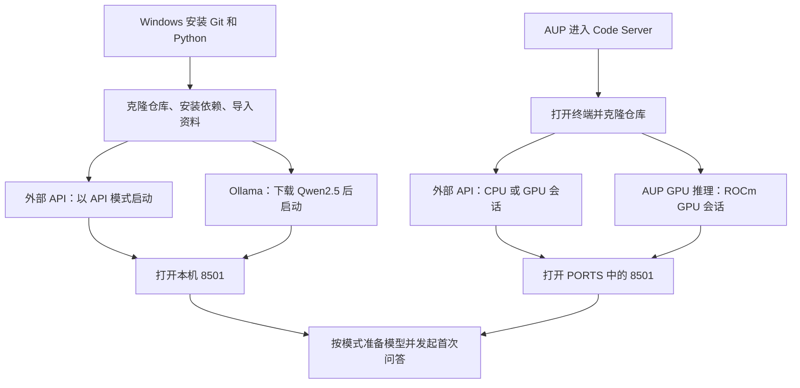
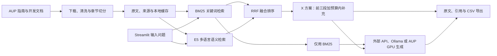

# AUP 云端开发入门助手

面向第一次使用 AMD AUP Learning Cloud 的学生和科研开发者。输入报错或操作问题，网页会从 AUP 用户指南和相关开发文档中查找证据，给出中文操作建议，并显示引用原文。可以接入 OpenAI 兼容 API、在 Windows 上用 Ollama 推理，或用 AUP 的 AMD GPU 生成答案。网页也提供直接阅读原文的检索预览。

[首次安装](#怎么装) · [启动与验证](#怎么跑) · [系统设计](#系统设计) · [评测结果](#效果如何) · [已知问题](#已知问题)

## 这是什么

新手把实验代码迁移到 AUP 时，常见的卡点是选择 Python 命令、安装依赖、启动服务、在浏览器访问云端端口，以及在会话结束前保存结果。示例问题包括“终端为什么找不到 python”和“Streamlit 显示 localhost:8501，应该从哪里打开”。回答中的 `[P1]`、`[P2]` 对应本次实际检索到的片段，可以展开查看原文与来源链接，再按自己的环境执行。

默认资料清单包含 AUP 用户指南正文 4 页、Git 与 Python 等相关开发文档 16 页，以及本项目自己的运行说明。资料库保留章节、链接和抓取日期。页面根据来源清单从公开网站获取当前内容。历史评测使用了当时冻结的 716 个片段，后来部署时看到的片段数量可能随上游页面更新而变化。

## 怎么装

先按自己的运行环境选择 [Windows 本地首次安装](#windows-本地首次安装) 或 [AMD AUP 云端首次安装](#amd-aup-云端首次安装)。有服务商密钥时，可以选择外部 API，网页和默认的 BM25 检索都可以在 CPU 上运行。选择 Ollama 或 AUP GPU 推理时，需要下载对应的生成模型。首次部署还需要联网安装 Python 依赖和导入官方资料。



### Windows 本地首次安装

#### 1. 安装依赖并导入资料

安装 [Git](https://git-scm.com/download/win) 和 [Python 3.12](https://www.python.org/downloads/)，重新打开 PowerShell。在你想保存项目的目录逐行执行下列命令。用虚拟环境中的 Python 安装依赖，便于和其他项目的环境分开。

```powershell
git --version
py -3.12 --version
git clone https://github.com/Deng0430/simple-rag-amd.git
Set-Location simple-rag-amd
py -3.12 -m venv .venv
.\.venv\Scripts\python.exe -m pip install -r requirements.txt
.\.venv\Scripts\python.exe prepare_knowledge.py
```

资料导入完成后，终端会输出 `Imported ... pages, ... chunks`。如果个别来源显示 `FAILED`，可根据日志核对地址和失败原因，在网络恢复后重新导入。也可以从网页的「资料库」确认本次能检索到哪些文档。

#### 2. 选择一种生成方式并启动

**外部 API。** 有 API 密钥时，在仓库目录直接运行下列命令。

```powershell
.\start_local.ps1 -Backend api
```

**本机 Ollama。** 要在自己的电脑上运行生成模型，先安装 [Ollama](https://ollama.com/download/windows)，从开始菜单打开它，再下载 Qwen2.5。量化权重约 **1.9 GB**。如果命令提示无法连接，先在另一个 PowerShell 窗口运行 `ollama serve` 并保留该窗口。

```powershell
ollama --version
ollama pull qwen2.5:3b
ollama list
```

确认 `ollama list` 中有 `qwen2.5:3b` 后，在仓库目录运行以下命令。

```powershell
.\start_local.ps1
```

Ollama 的默认模型目录为 `%USERPROFILE%\.ollama\models`。本地 D/H/X 使用固定的 Q4_K_M 权重，预期模型 ID 前缀为 `357c53fb659c`。遇到同名标签指向其他权重的情况，可在「演示参数」中切换到「自定义检索演示」，并记录实际模型版本。

如果当前 PowerShell 环境限制运行脚本，可以将 `RAG_BACKEND` 设为所选的 `api` 或 `ollama`，再直接启动网页。选择 `ollama` 时，先启动 Ollama 服务。

```powershell
$env:RAG_BACKEND = 'api'
.\.venv\Scripts\python.exe -m streamlit run app.py --server.address=127.0.0.1 --server.port=8501
```

#### 3. 打开网页并验证首次问答

打开 [http://127.0.0.1:8501/](http://127.0.0.1:8501/)。如果端口被占用，在启动脚本的命令后加 `-Port 8502`，然后打开对应端口。使用外部 API 时，按下方的[网页 API 配置](#网页-api-配置)填写字段并提交问题。使用 Ollama 时，在左侧选择「本地 / Ollama」和「模型问答」，保留默认模型后试用一道示例题。

选择 E5 或 D/H/X 后，第一次查询会下载嵌入模型并编码文档。可以在提问前用 `.\.venv\Scripts\python.exe embedding_model.py` 预下载 E5，索引仍在首次查询时建立。本地 D/H/X 也会自动准备固定的 Qwen2.5 分词器，用于核对证据预算。

### AMD AUP 云端首次安装

#### 1. 选择会话并克隆仓库

进入 [AUP Learning Cloud](https://tpe.aupcloud.io/hub/home)。使用外部 API 可选支持终端和端口转发的 CPU 或 GPU 会话。要在 AUP 上运行生成模型，选择预装 ROCm PyTorch 的 **VSCode Server GPU**，并为下载和加载模型留出会话时间。

打开 Code Server，在 **Terminal → New Terminal** 中执行以下命令。

```bash
cd /home/jovyan
git clone https://github.com/Deng0430/simple-rag-amd.git
cd simple-rag-amd
```

#### 2. 选择一种生成方式并启动

**外部 API。** 在 CPU 或 GPU 会话中运行以下命令。

```bash
RAG_BACKEND=api bash start_aup.sh
```

**AUP GPU 推理。** 在 GPU 会话中运行以下命令。

```bash
bash start_aup.sh
```

两种方式都会准备项目虚拟环境、安装依赖并导入资料。GPU 方式还会检查 ROCm 与显卡，并维持平台预装的 PyTorch 版本。若镜像缺少 `ensurepip`，脚本会使用 PyPA 的 virtualenv。终端出现 `Starting Streamlit on port 8501` 后，保留进程，在 Code Server 的 **PORTS** 面板打开 **8501** 对应的转发链接。如果端口未出现在列表，可以先添加或转发 8501。日志中的 `localhost:8501` 是云端地址，电脑浏览器使用平台给出的转发地址。

#### 3. 准备模型并验证首次问答

**外部 API。** 按下方的[网页 API 配置](#网页-api-配置)填写字段，选择「模型问答」并提交问题。初始配置使用 BM25。

**AUP GPU 推理。** 在左侧选择「AUP / Transformers」和「模型问答」，保留默认 `Qwen/Qwen3-4B-Instruct-2507` 与 X。首次问答会准备 E5 索引，从 Hugging Face 读取 Qwen3 分词器和权重，加载到 AMD GPU 并预热。Qwen3 权重约 **8 GB**，E5 模型文件和分词器约 **135 MB**。Qwen3 权重通常缓存在 `~/.cache/huggingface/hub`，E5 文件与索引保存在仓库的 `.cache/retrieval/`。

正式演示前，可以在依赖安装成功后另开一个 AUP 终端，预下载两个模型，再回网页提交一道示例题以建立索引并加载模型。

```bash
cd /home/jovyan/simple-rag-amd
.venv/bin/python embedding_model.py
.venv/bin/hf download Qwen/Qwen3-4B-Instruct-2507
```

模型文件传输进度对应下载，`Loading checkpoint shards` 对应从磁盘读取分片。服务重启后能复用已有的模型文件，首次问答会再加载模型。下载报错时，先看终端指出的是 E5 还是 Qwen3，检查网络和剩余磁盘空间后重试对应命令。

### 网页 API 配置

按上述平台命令启动后，在网页左侧打开 **模型与运行环境 → 外部 API / OpenAI 兼容**，填入服务商提供的 **API 地址、模型 ID、API 密钥**。选择 **模型问答**，提交一道示例题。

| 服务商示例 | API 地址 |
| --- | --- |
| OpenAI | `https://api.openai.com/v1` |
| DeepSeek | `https://api.deepseek.com/v1` |
| 阿里云百炼（中国大陆） | `https://dashscope.aliyuncs.com/compatible-mode/v1` |
| OpenRouter | `https://openrouter.ai/api/v1` |

项目通过 HTTPS 调用兼容的 Chat Completions 接口。对于其他可信服务，部署者可在启动前通过 `RAG_API_ALLOWED_HOSTS` 加入域名，多个域名用逗号分隔。模型 ID 使用供应商控制台中的值，密钥填入网页密码框并用于当前会话。

默认 BM25 使用 CPU 查找相关材料。切换 D/H/X 时会准备 E5 和参考分词器，证据预算使用参考分词器估算，实际 token 以服务商返回的数据为准。问答请求会向所选服务商发送当前问题和检索到的片段，费用与限额按服务商规则计算。CSV 保存服务域名、模型、答案与证据。

## 怎么跑

项目已安装时，进入仓库目录，用与运行环境和模型对应的命令重启网页。应用会复用现有的文档、索引和模型缓存。

| 环境 | 使用外部 API | 使用机器上的模型 |
| --- | --- | --- |
| Windows | `.\start_local.ps1 -Backend api` | `.\start_local.ps1` |
| AMD AUP | `RAG_BACKEND=api bash start_aup.sh` | `bash start_aup.sh` |

在 AUP 的 GPU 会话中，使用 Code Server 打开仓库目录后还可按 **Ctrl+Shift+B** 运行默认 GPU 启动任务。需要更新仓库时，先在旧服务的终端按 **Ctrl+C**，再运行 `git pull --ff-only`，更新成功后按上表启动。已打开的网页也可以在「模型与运行环境」中直接切换后端。

**只查原文。** 安装依赖并导入资料后，可在 Windows 项目目录直接启动网页，选择「仅检索预览 → 自定义检索演示 → BM25」。选择 E5 或 X 时会准备 E5 资源。

```powershell
.\.venv\Scripts\python.exe -m streamlit run app.py --server.address=127.0.0.1 --server.port=8501
```

### 验证问答与导出

| 使用场景 | 网页操作 | 验证方式 |
| --- | --- | --- |
| 排查 Python 命令 | 保留当前后端的默认检索方案，选择“模型问答”，输入“为什么终端提示 python: command not found？” | 检查回答是否建议先用 `python3 --version` 确认当前环境，并查看引用原文 |
| 查找云端端口说明 | 选择“仅检索预览”，输入“Streamlit 启动了，为什么网页打不开？” | 展开靠前的片段，找到云端监听地址与浏览器转发地址的区别 |
| 对比关键词与语义检索 | 选择“自定义检索演示 → 对比三种检索器（只检索）”，用同一问题查询 | 比较各方法排在前面的来源和实际覆盖的要点，各方法的分数应在本方法内比较 |

问答结束后展开“引用材料”，对照命令、工作目录、版本和执行前提。点击“下载本次结果 CSV”会保存该次回答的证据快照。`evidence_text` 便于直接阅读，`passages_json` 保存每个片段、来源和检索元数据，`citation_id` 对应页面编号。外部 API 和 D/H/X 模型问答的 `raw_answer` 字段也会保存模型的结构化输出。首次复现可以保留一份 CSV，作为从网页启动到导出成功的记录。

## 系统设计

### 系统架构



资料准备和问答可以分开。`prepare_knowledge.py` 保存章节片段和来源，第一次使用 E5 时编码文档并建立向量缓存，之后按资料内容和模型版本复用。在线问答先找证据，再把选中的原文交给生成模型。网页同时显示答案、来源和运行指标，方便回看生成时实际使用的内容。

### 技术选型

| 环节 | 实现 | 选择理由 |
| --- | --- | --- |
| 文档与界面 | Python、Beautiful Soup、Streamlit | 在同一个 Python 项目中完成文档处理、交互和导出，便于在本地和 AUP 使用同一套界面 |
| 关键词检索 | TF-IDF 字符 2–4 gram、BM25 与中文分词 | 保留报错、命令和参数的字面信息，方便对比不同检索器 |
| 语义检索 | multilingual-e5-small、CPU ONNX int8、384 维 | 补充中文问题与英文文档之间的语义匹配，检索不占用生成模型所需的 GPU 资源 |
| 排序与证据 | 等权 RRF、Top-3 基础片段、额外 512 token | 以排名融合不同尺度的检索分数，将补充证据限制在可控的输入预算内 |
| 向量缓存 | NumPy 矩阵与本地文件 | 资料库规模较小，可以随项目运行，省去单独部署向量服务 |
| 生成 | OpenAI 兼容 API、本地 Qwen2.5-3B / Ollama、云端 Qwen3-4B-Instruct-2507 / ROCm PyTorch | 外部 API 适合首次复现，本地与云端模型分别用于可控实验和 AMD GPU 实践 |

**D** 使用语义检索前三段，**H** 使用 E5 与 BM25 融合后的前三段，**X** 在 H 的基础上继续按融合排名补入完整片段，上限为额外 512 token。自定义模式可以单独切换 TF-IDF、BM25、E5，并调整 Top-k。Top-k 表示基础检索规模，X 的最终证据还可能包含补入的片段。

### 代码入口

| 路径 | 主要用途 |
| --- | --- |
| `app.py` 和 `assets/style.css` | 网页、侧栏、问答与资料库 |
| `prepare_knowledge.py` 和 `knowledge.py` | 下载公开资料、按章节切分、读取缓存 |
| `retrievers.py` 和 `embedding_model.py` | 关键词与语义检索、模型文件和索引管理 |
| `hybrid_retrieval.py` 和 `hybrid_runtime.py` | D/H/X 排序策略、证据组装、生成调用 |
| `answer_protocol.py`、`structured_model.py`、`api_backend.py` 和 `rag.py` | 答案结构、模型适配与 CSV 导出 |
| `data/source_manifest.json` | 官方资料入口与许可说明 |
| `start_local.ps1`、`start_aup.sh` 和 `tests/` | 本地/云端启动及随仓库提供的测试 |

## 效果如何

### 本地证据方案对比

在一组 50 道开发文档题上，D、H、X 共用同一份资料和 Qwen2.5-3B（Q4_K_M）。D 为 E5 Top-3 基线。EM 检查短答案精确匹配，Token-F1 检查词元重合，条件 Slot-F1 核对预先指定的必要条件，完整回答可接受率还要求操作建议及所需条件能够成立。下面只展示汇总指标。

| 方案 | EM | Token-F1 | 条件 Slot-F1 | 完整回答可接受率 | 平均输入 token |
| --- | ---: | ---: | ---: | ---: | ---: |
| D：E5 Top-3 | 18.00% | 42.43% | 36.19% | 10/50（20%） | 848.46 |
| H：融合 Top-3 | 20.00% | 45.37% | 39.60% | 12/50（24%） | 965.90 |
| X：融合并补充原文 | 38.00% | 58.29% | 41.90% | 15/50（30%） | 1462.68 |

这轮实验中，X 相对 D 的 EM 提高 20 个百分点，输入 token 增加约 72%。完整回答可接受率和条件 Slot-F1 的配对描述区间跨零，排序结果用于决定课程版的默认方案。题集与语义评分使用了 AI 辅助，观察范围限于该题集、模型和运行配置。这些数字用于说明增加证据的收益与成本。

### 云端与功能验证

AUP 的一次 10 题网页测试使用 X 与 Qwen3-4B-Instruct-2507，10 次输出均可解析且未截断。严格核对答案、操作前提和引用后，8 道操作题中有 2 道完整通过，两道范围外的问题均给出合理拒答。网页计时平均 11.43 秒，含检索和回答生成，首次模型下载、加载、预热及页面渲染另外计算。常见失败是参数混淆或引用只提供了章节标题，使用时应以原文为准。

Python 单元测试覆盖检索融合、证据预算、后端响应、文档解析与导出等路径，使用小型输入。安装依赖后可以独立运行检查。

```powershell
# Windows，仓库根目录
.\.venv\Scripts\python.exe -m unittest discover -s tests -v
```

```bash
# AUP，启动脚本已准备项目环境后
.venv/bin/python -m unittest discover -s tests -v
```

## 已知问题

| 现象 | 原因和处理 |
| --- | --- |
| 进入 AUP 网页后，第一次问答等待较久 | 先查 AUP 终端正在下载、编码还是加载分片。正式演示前可提前获取模型并完成一道问答。 |
| 找不到本地模型 | 用 `ollama list` 查看当前 Ollama 服务的模型，确认已下载到该服务使用的目录。如果另设 `OLLAMA_MODELS`，需要让服务在对应环境下启动。 |
| 外部 API 返回 401、404 或 429 | 401 检查密钥，404 核对 API 地址和模型 ID，429 检查服务额度或速率限制。运行结果可用检索预览继续核对来源。 |
| 云端能看到 Streamlit 日志，自己电脑打不开 | 检查 AUP 会话和运行终端是否仍在，用 PORTS 面板打开转发链接。会话结束后需要重新启动服务。 |
| 问题没有指定仓库，答案却给了本项目的更新命令 | 当前知识库同时收录通用文档和本项目说明，检索可能偏向后者。提问时可明确目标仓库、首次克隆或更新，以及要运行的入口。 |
| 选项答对了，引用却支撑不了关键结论 | 系统检查输出结构和引用编号，逐条支持关系仍需阅读原文。遇到高风险配置命令时先核对适用版本、路径和前提。 |
| 会话重启后结果不见了 | 答案保存在当前网页会话。刷新、停止服务或云端时限到期前，先下载需要保留的 CSV。 |
| 拉取更新时提示分支分歧 | `git pull --ff-only` 会停止，后续启动不会执行。先用 `git status` 检查现有仓库并保存自己的更改。 |

资料库大小取决于导入结果。希望主动更新官方文档时，在项目环境执行 `prepare_knowledge.py --refresh`，更新后第一次语义查询会重新核对索引。系统的知识范围是已导入的技术资料，账户配额、实时服务器状态和具体项目所需的配置应从相应平台与项目说明确认。

代码采用 [MIT 许可](LICENSE)。第三方资料和模型归属见 [来源说明](data/ATTRIBUTION.md)。公开内容包含系统部署所需代码、资料来源和汇总结果。
