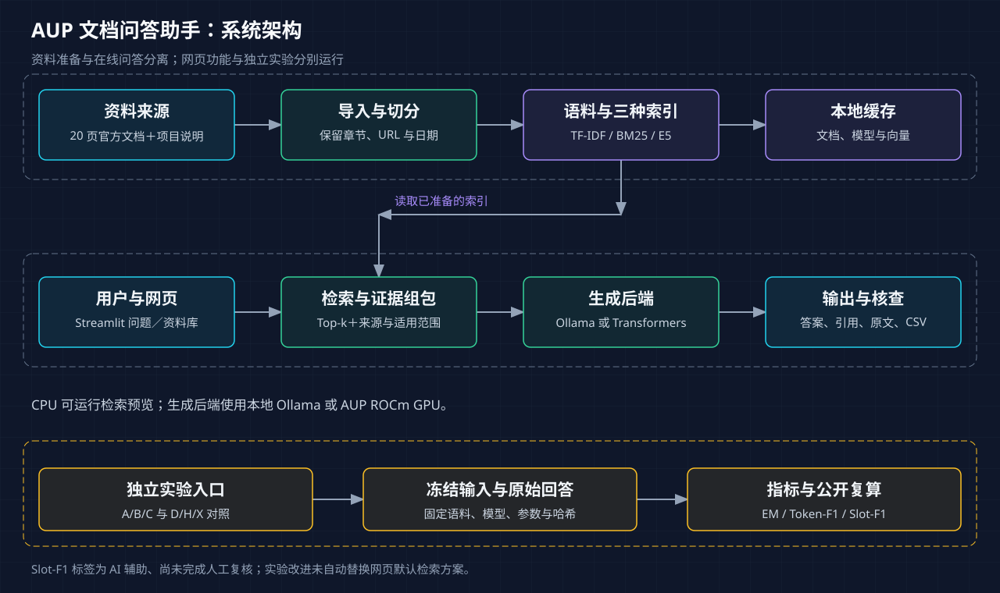

# AUP 云端开发入门助手

一个可运行在 **AMD AUP Learning Cloud** 或本地 Ollama 上的资料问答网页。学生描述环境配置、网页访问或文件保存问题，系统检索官方文档，再用语言模型整理带引用的操作建议。

## 这是什么

### 使用场景

初次进入 AUP Code Server 的学生，经常遇到“找不到 Python”“网页启动了却打不开”“AMD 为什么也用 torch.cuda”等问题。本项目先从指定资料检索依据，再由语言模型整理操作建议。使用者可以展开原文，核对版本、来源和适用条件，最后自行决定如何操作。引用是核查入口，不能单凭出现引用就认定每句话都正确。

- 导入 AUP 用户指南全部 4 页正文，加 Python、pip、Git、VS Code、Streamlit、PyTorch HIP、Hugging Face Hub 的指定开发文档，共 20 页，另附本项目使用说明。
- 在“演示参数”切换 **TF-IDF、BM25、多语言 E5 稠密检索**，调整 Top-k，或并排比较三种检索器的排名、原文、分数和查询耗时。
- 支持仅检索预览、AUP GPU 模型问答、本地 Ollama 模型问答、来源展开和 CSV 下载。资料库支持关键词、主题筛选与分页。
- 旧版 40 条原创 FAQ 移至 `data/archive/aup_faq_v2.json`，仅供历史测试；它们的正文不加入当前检索库。

“完整”指 [资料清单](data/source_manifest.json) 中的 AUP 用户指南 4 页正文；其他工具导入的是清单中的具体页面，未抓取所有网站。切分数量随上游正文变化，页面显示实际导入状态。

这是课程 demo，不能查询账户或服务器状态，也不会替用户执行命令。回答依据和资源状态请结合原文、实际版本与 AUP 页面核对。详见[部署与演示说明](docs/aup-demo.md)。

### 系统架构



资料准备与在线问答分别运行：先下载、清洗和切分文档，再建立索引；收到问题后，检索器选择片段，生成后端整理回答，网页展示答案、原文和运行记录。独立实验另行冻结输入、生成响应和计算指标；H/X 改进属于实验入口，尚未集成为网页选项。模块、数据和缓存边界见 [架构说明](docs/system-architecture.md)。

## 怎么装

### 选择运行路径

| 路径 | 前置条件 | 能完成什么 |
| --- | --- | --- |
| CPU 检索预览 | Python、项目依赖、能访问资料来源；E5 首次还需下载模型 | 查资料、比较检索器、导出结果 |
| Windows 本地问答 | 上述条件，加 Ollama 和已下载的 qwen2.5:3b | 使用本地 Qwen2.5-3B 生成答案 |
| AUP GPU 问答 | 有权限的 AUP GPU 资源，平台预装 ROCm PyTorch | 使用 Transformers 与 Qwen3-4B 生成答案 |

本地维护环境使用 Python 3.11；依赖范围以 [requirements.txt](requirements.txt) 为准，实际版本随安装时间变化。首次文档下载、嵌入索引准备、生成模型下载和加载是不同阶段，网络和缓存会明显影响等待时间。使用命令时应区分 Windows PowerShell 与 AUP Bash，安装依赖和运行程序始终使用同一个虚拟环境解释器。

### 本地首次安装

```powershell
git clone https://github.com/Deng0430/simple-rag-amd.git
Set-Location simple-rag-amd
py -3.11 -m venv .venv
.\.venv\Scripts\python.exe -m pip install -r requirements.txt
.\.venv\Scripts\python.exe prepare_knowledge.py
```

已经克隆并准备好虚拟环境时，进入原项目目录即可，不要覆盖已有环境。Python 启动器没有 3.11 时，先安装该版本或使用经过验证的兼容解释器。资料尚未导入完时，网页仅有项目说明并给出提示；在网络恢复后重试导入，记录未成功下载的页面。导入脚本只读取清单指定的公开资料，不会执行页面中的操作指令。

仅检索预览无需在项目环境安装 PyTorch。本地模型问答先安装 [Ollama](https://ollama.com/download)，然后在它使用的实际模型目录准备权重：

```powershell
ollama pull qwen2.5:3b
ollama list
```

`pull` 需要网络和足够磁盘空间，已有模型无需重复下载。使用自定义目录时，应先配置并重启 Ollama 服务，再确认 `ollama list` 可见模型。本项目不分发权重，不能将开发电脑的磁盘路径直接照搬到其他电脑。

### 在 AUP 安装与启动

首次克隆时，在 GPU Code Server 终端执行：

```bash
cd /home/jovyan
git clone https://github.com/Deng0430/simple-rag-amd.git
cd simple-rag-amd
bash start_aup.sh
```

在 AUP 选择 **Development Environments → VSCode Server GPU**。将仓库克隆至 `/home/jovyan`，进入项目后执行：

```bash
bash start_aup.sh
```

已经克隆时，先停止旧网页，再更新并启动：

```bash
cd /home/jovyan/simple-rag-amd && git pull --ff-only && bash start_aup.sh
```

也可用 **File → Open Folder** 打开项目文件夹，按 **Ctrl+Shift+B** 运行默认任务。服务监听 8501，从 Code Server **PORTS 面板**打开转发地址；云端 localhost 不会自动指向本机浏览器。

脚本会检查 GPU、准备环境、安装依赖并首次导入官方文档，复用平台已有的 ROCm PyTorch。缺少 ensurepip 时自动使用 PyPA virtualenv。首次模型问答会加载 `Qwen/Qwen3-4B-Instruct-2507`；首次 E5 检索会下载嵌入模型并建立向量索引。提前运行一次可减少现场等待。**不要用普通 PyPI PyTorch 覆盖平台的 ROCm 构建。**

## 怎么跑

### 示例一：只查资料

在 Python 环境中执行（AUP 使用 `.venv/bin/python`，Windows 可使用 `.venv\Scripts\python`）：

```bash
python -m pip install -r requirements.txt
python prepare_knowledge.py
python -m streamlit run app.py
```

“仅检索预览”可以在 CPU 上运行三种检索器；此时不生成答案，模型 token 留空。本地模型问答可使用下面的 Ollama 方式，无需在项目 Python 环境中安装 PyTorch。文档未导入时仅有项目说明，网页显示提示并提供准备按钮。

在“演示参数”选择单次检索或三种检索器对照，输入“为什么 AMD 显卡也使用 torch.cuda 接口？”。预期看到排序后的资料片段、来源、适用范围和检索耗时。查看 PyTorch HIP 原文时核对文档版本，再将建议用于自己的环境。TF-IDF 和 BM25 不需生成模型，首次 E5 仍需单独准备嵌入模型与文档向量。

### 示例二：Windows 本地 Qwen2.5-3B

本地使用已安装的 Ollama 模型 `qwen2.5:3b`。请先准备项目 `.venv` 和依赖，并确认 Ollama 已安装、模型文件已存在。在项目目录的 PowerShell 中运行：

```powershell
.\start_local.ps1 -ModelsPath 'D:\ollama_models'
```

`D:\ollama_models` 是这台开发电脑的模型目录，其他电脑需改成实际路径；使用 Ollama 默认目录或已配置 `OLLAMA_MODELS` 时可省略 `-ModelsPath`。脚本从项目目录启动网页，默认地址为 `http://127.0.0.1:8501`。端口被占用时可加 `-Port 8502`。

脚本会检查现有模型和依赖，并在 Ollama 未启动时后台启动服务；它不会下载模型或安装依赖。已有 Ollama 服务会直接复用，`-ModelsPath` 不会改变该服务的模型目录。如果模型缺失，先检查现有服务使用的目录；需要换目录时自行关闭并重启 Ollama，再运行脚本。按 `Ctrl+C` 停止网页后，Ollama 保留运行，方便继续评测。

网页“模型与运行环境”可切换生成后端。AUP 默认使用 Transformers 与 `Qwen/Qwen3-4B-Instruct-2507`；本地启动脚本选择 Ollama 与 `qwen2.5:3b`。Ollama 的 CPU/GPU 分配由其服务决定，连接成功不代表模型全部运行在 GPU 上。

选择“模型问答”，确认 Ollama 与模型名称，输入“为什么终端提示 python: command not found？”。预期得到带 `[P1]` 等标记的建议、检索原文和 CSV 下载入口。应将检查 `python3`、使用项目虚拟环境等建议与来源对应；命令缺失本身不能证明安装了 Python 2。网页会话不是永久存储，刷新、重启或关闭资源前应先下载结果。

保持 Ollama 服务运行后，可在本地执行一次现有问答流程检查：

```powershell
.\.venv\Scripts\python.exe evaluate.py --backend ollama --model qwen2.5:3b --retriever dense --limit 1 --num-ctx 8192 --output runs/local_qwen25_smoke.csv
```

这条命令只验证模型接入、检索和答案导出。独立实验入口已完成 20 题 A/B/C 证据组织实验，以及新增 12 题、旧 20 题的 D/H/X 检索改进实验，结果见下文。网页与正式实验使用不同的提示入口，接入检查不计入正式指标。

网页默认上下文窗口为 8192 token。请求前使用保守的 UTF-8 字节上界检查，超过窗口时明确拒绝，不自动截断资料；这不是精确 token 计数。CSV 中的 token 数来自 Ollama 实际响应。独立实验使用固定 Qwen tokenizer 对完整 ChatML 输入精确组包，并与服务返回的输入 token 数核对。

默认复用文档快照；重新抓取使用 `python prepare_knowledge.py --refresh`。正文按章节和段落切分，保留命令、出处与抓取日期。

### 索引与缓存

| 检索器 | 索引与查询方式 |
| --- | --- |
| TF-IDF | scikit-learn 字符 2—4 gram 稀疏向量，按余弦相似度排序 |
| BM25 | jieba 中文分词及英文 API 词元，使用 BM25Okapi 排序 |
| E5 | intfloat/multilingual-e5-small，384 维，CPU ONNX int8；对归一化文档向量做余弦检索 |

当前规模使用 **NumPy 向量矩阵与本地缓存文件**，无需另开向量数据库服务。文档向量按正文和嵌入模型版本生成缓存键，资料变化后自动重建。E5 使用 query: / passage: 前缀；ONNX 文件来自 Xenova/multilingual-e5-small，下载时记录实际 revision 并检查文件完整性。

文档快照在 `.cache/knowledge/`，嵌入模型与 `.npz` 向量索引在 `.cache/retrieval/`；均不提交 GitHub。云端和其他电脑首次运行时各自准备缓存。

### 示例三：批量比较检索器

运行 6 道快捷问题，导出三种检索器的真实结果：

```bash
python evaluate.py --preview --retriever all --limit 6 --output runs/retrieval_comparison.csv
python -m unittest discover -s tests -v
```

三种检索器、六道问题会导出 18 条逻辑结果。命令从项目根目录运行，输出目录由程序创建；Windows 可将 `python` 换成 `.\.venv\Scripts\python.exe`，AUP 换成 `.venv/bin/python`。比较同一问题的排名与原文，检查关键词和语义检索各自遗漏了什么。结果保存在被 Git 忽略的 `runs/`，重要文件需另行备份。

GPU 问答和同一检索器的 Top-k 对比：

```bash
python evaluate.py --retriever bm25 --limit 6 --output runs/aup_demo.csv
python evaluate.py --retriever dense --top-k 3 6 --limit 6 --output runs/dense_demo.csv
python summarize_results.py runs/aup_demo.csv
```

批量推理前先停止网页，避免并发问答干扰计时；Transformers 后端还需避免加载两份生成模型。CSV 记录检索器、资料 ID、分数、耗时及实际生成 token。汇总脚本仅处理同一检索器和模型运行配置的回答，正确率来自另行人工标注；它不接受仅检索结果。

本地 Qwen2.5-3B 与 AUP Qwen3-4B 的模型、量化和设备不同，结果应分别保存、分别汇总，不合并为同一对照实验，也不能直接比较延迟来判断平台快慢。Ollama 输出记录服务返回的 token、加载和生成耗时；没有测量的 PyTorch 峰值内存字段留空，空值不代表占用为零。

三种分数尺度不同，**不能横向比较数值大小，也不是答案正确率**。E5 默认保留 Top-k，尚未校准无关问题的拒答门槛。查询耗时包含问题编码与搜索，首次下载、索引准备和生成模型加载另算。旧 FAQ 与 SQuAD 的 GPU 记录不代表新资料库已经完成 GPU 复测。

历史数据可显式指定：

```bash
python evaluate.py --data data/archive/aup_faq_v2.json --preview --limit 40 --output runs/legacy_preview.csv
python evaluate.py --data data/squad_demo.json --top-k 3 6 --preview --output runs/squad_preview.csv
```

## 效果如何

### 已有评测与基线

在固定的 716 段资料快照上，使用本地 **Qwen2.5-3B / Q4_K_M** 研究：检索到相关文档后，如何保留答案中的适用条件与关键约束。模型不训练；题目、语料、提示、配置与结果分别保存。

- [第一轮：条件线索优先的邻域扩展](docs/condition-experiment-results.md)：20 题、A/B/C 三组。19 题 B/C 输入相同，没有足够证据证明条件优先优于普通邻域扩展。
- [第二轮：混合检索与全局补充](docs/retrieval-improvement-v2.md)：E5 基线 D、BM25＋E5 的 RRF 融合 H、融合后再补最多 512 token 的 X。新增 12 题和旧 20 题分别报告。

| 第二轮数据集 | D EM / Token-F1 / Slot-F1 | H EM / Token-F1 / Slot-F1 | X EM / Token-F1 / Slot-F1 |
| --- | --- | --- | --- |
| 新增 12 题 | 33.33 / 57.64 / 16.00 | 33.33 / 61.13 / 14.81 | 33.33 / 61.60 / 13.79 |
| 已暴露的旧 20 题 | 40.00 / 52.07 / 42.86 | 40.00 / 52.69 / 38.10 | 45.00 / 57.16 / 52.17 |

表中均为百分比。EM/Token-F1 采用保留命令符号的固定中英文分词规则；Slot-F1 为 AI 辅助语义核查，**尚未完成人工复核**。全局补充在旧题上有局部收益，在新增任务上未改善条件完整性，因此网页默认方案保持不变。服务异常、失败和截断均保留记录，不把这些小样本描述为通用性能结论。

EM 衡量有限短答案参考的精确匹配；Token-F1 衡量答案与参考的词元重合，保留大小写、命令和标点，并非英文 SQuAD 原版；Slot-F1 对完整回答检查必要条件，按 `2TP/(2TP+FP+FN)` 汇总。这三个指标关注不同问题，不能将词面重合、条件完整性、命令实际执行成功视为同一个结果。槽位标签不是专家金标准，人工复核前仍有语义判断误差。

公开的[逐题结果、配置摘要与复算入口](experiments/README.md)可直接核对主表，无需下载模型或完整文档：

```bash
python experiments/verify_results.py
```

完整第三方语料、全部提示和本机运行日志仍在被忽略的 `runs/` 中。公开统计复算与重新生成答案是两件事；[实验运行说明](docs/experiment-reproduction.md)说明历史脚本依赖和重新运行的边界。本地实验与历史 AUP / Qwen3 结果分开报告，不据此比较两种硬件的速度。

### 当前验证范围

2026-11-16，本地维护环境的现有 **60 项单元测试**与公开结果复算通过，本地 Ollama 真实问答和 CSV 导出也已检查。测试覆盖检索、缓存、上下文、后端协议及实验记录等逻辑，不代表每条答案正确或所有网页交互都经过验证。已有缓存的一次接入检查不能证明陌生电脑能在 30 分钟内完成首次部署；外部独立使用者的完整试用记录尚待补充。模块和验证范围见 [系统证据说明](docs/system-level-evidence.md)。

## 已知问题

### 回答与运行的边界

模型可能在正确引用附近补出来源不支持的解释。2026-11-16 接入检查中，回答将 `python` 命令缺失推断为“可能正在使用 Python 2”，该推断不足以由已检索资料支持。使用者应核对原文和实际环境，尤其检查命令、版本、前置条件和保存位置。目前尚无逐句引用支持性验证，返回片段或引用编号不能替代事实核验。

E5 未校准无关问题拒答门槛，CPU 查询成功也不能代替 GPU 模型问答验收。网页和独立实验的提示入口不同，完整历史实验还依赖未公开的本机归档。实时重抓网页不保证得到相同语料和模型输出，新增实验应另建目录，记录实际时间、资料、模型、提示与失败状态。

### 常见故障

| 现象 | 检查与处理 |
| --- | --- |
| 网页只有项目说明 | 检查导入提示，网络恢复后运行 `prepare_knowledge.py` |
| E5 首次等待较久 | 区分模型下载、文档编码和查询；预先准备索引，检查网络与缓存完整性 |
| Ollama 无法连接或找不到模型 | 确认服务地址和 `ollama list`，检查现有服务实际使用的模型目录 |
| 本地端口被占用 | 停止自己的旧网页，或启动脚本加 `-Port 8502`，不要结束不明进程 |
| 云端启动成功却打不开 | 在 Code Server 的 PORTS 面板打开转发地址，保留启动终端 |
| AUP 提示没有 ROCm/GPU | 确认平台 GPU 环境；CPU 预览使用 Streamlit 命令，AUP 脚本会检查 GPU |
| 上下文预算不足 | 减少 Top-k 或缩短问题，资源允许后显式增加窗口，避免静默截断 |
| 刷新后结果丢失 | 提前下载 CSV，单独备份被 Git 忽略的运行结果 |

首次下载、模型加载、预热与索引构建应分别计时，不能用剪去等待后的演示片长代替首次安装耗时。切换到检索预览也不保证已缓存的生成模型立即卸载。尚未测量的显存字段留空，不能解释为占用为零。

### 文件与许可

| 文件 | 用途 |
| --- | --- |
| app.py、assets/style.css | 网页及样式 |
| rag.py、retrievers.py、embedding_model.py | 问答、三种检索器、嵌入模型准备 |
| knowledge.py、prepare_knowledge.py、data/source_manifest.json | 文档导入、章节切分及来源清单 |
| docs/project-usage.md | 参与检索的项目自身操作说明 |
| evaluate.py、summarize_results.py | 结果导出及模型回答汇总 |
| start_aup.sh、.vscode/tasks.json | AUP 快捷启动 |
| start_local.ps1 | Windows 本地 Ollama 网页启动 |
| condition_*.py、retrieval_experiment.py、retrieval_runtime.py、hybrid_retrieval.py | 冻结输入、上下文实验、混合检索与运行记录 |
| data/condition_eval/、data/retrieval_eval_v2/ | AI 辅助构建的问题、评分参考及协议 |
| experiments/、docs/*experiment*.md、docs/retrieval-improvement-v2.md | 可公开的逐题结果、复算与实验说明 |
| data/archive/、data/squad_demo.json | 历史测试资料 |

代码和原创项目说明采用 MIT。第三方文档、SQuAD 数据、模型及商标保留各自许可；下载的原文与模型权重不随仓库再分发。来源与许可见 [ATTRIBUTION.md](data/ATTRIBUTION.md)。
