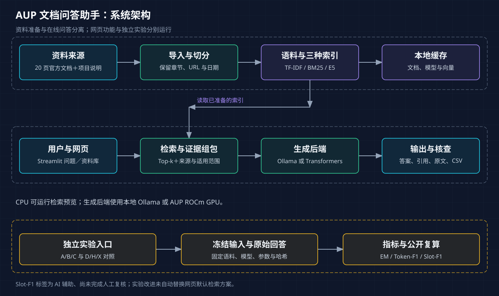

# 系统架构与数据边界

矢量源文件为 [system-architecture.svg](images/system-architecture.svg)，[PNG 预览](images/system-architecture@2x.png)用于不支持 SVG 的阅读环境。图中在线问答与独立实验分别运行，不能将实验中的 H/X 方法当成网页已提供的选项。

## 资料准备

`data/source_manifest.json` 指定 20 个公开页面：AUP 用户指南 4 页正文及 16 页相关开发文档。`prepare_knowledge.py` 下载正文，保留来源、章节与抓取日期，调用 `knowledge.py` 的切分逻辑生成本地语料。`docs/project-usage.md` 在加载时作为项目专用知识加入；旧 FAQ 正文不进入当前资料库，只沿用六道快捷问题。

默认复用 `.cache/knowledge/`；`--refresh` 才重新抓取。实时页面可能变化，当前网页片段数应以实际导入状态为准。正式实验另有冻结的 716 段资料快照与哈希，不能将新抓取的正文冒充历史快照。

## 检索与问答

| 模块 | 入口 | 主要职责 |
| --- | --- | --- |
| 网页交互 | `app.py`、`assets/style.css` | 参数选择、问题提交、检索对照、资料筛选、来源展示及下载 |
| 资料管理 | `knowledge.py`、`prepare_knowledge.py` | 清单导入、分段、项目说明与缓存状态 |
| 检索 | `retrievers.py`、`embedding_model.py`、`rag.Retriever` | TF-IDF、BM25、E5，嵌入模型准备与向量缓存 |
| 生成与导出 | `rag.py` | 组装带编号的证据、调用后端、校验响应、记录 token 与 CSV |
| 批量检查 | `evaluate.py`、`summarize_results.py` | 批量问答、检索对照及同配置汇总 |
| 独立实验 | `condition_*.py`、`hybrid_retrieval.py`、`retrieval_*.py` | 冻结输入、A/B/C 与 D/H/X 对照、失败恢复及评分 |

TF-IDF 使用字符 2—4 gram，BM25 使用 jieba 与 API 词元，E5 使用 multilingual-e5-small 的 CPU ONNX int8 编码。文档向量按正文和模型 revision 缓存为 `.npz`，查询时与 NumPy 矩阵计算余弦相似度，无需额外向量数据库服务。三种分数不能直接比较。

网页先检索片段，再以 `[P1]` 等编号传给生成模型。生成后端可以是 AUP Transformers / Qwen3-4B，也可以是本地 Ollama / Qwen2.5-3B。网页的 Ollama 入口采用 `/api/chat` 和保守 UTF-8 字节上界检查；正式实验采用固定 tokenizer、完整 ChatML 和 `/api/generate raw=true`，两者的提示与预算处理不同。

## 结果与限制

网页展示答案、原文、来源 URL、适用范围和运行记录，CSV 保留当次问题、检索器、片段 ID、模型与耗时。会话状态不会替代持久备份，刷新前应下载。未测量的显存字段为空，不能解释为零。

系统不读取用户账户、配额或服务器状态，不代替使用者执行命令。E5 的无关问题门槛尚未校准，引用支持性也没有逐句自动验证。模型可能补出无来源的解释，使用者仍需核对原文及实际环境。

## 独立实验与公开记录

第一轮比较 A/B/C，第二轮比较 D/H/X；旧 20 题回归和新增 12 题分别统计。公开的 `experiments/` 包含 156 个逻辑位置的回答、标签、配置摘要、哈希与复算入口。它能复核保存的统计，不能单独恢复全部历史提示、完整第三方语料或模型输出。Slot-F1 标签为 AI 辅助且人工复核未完成。

复算入口见 [experiments/README.md](../experiments/README.md)，重新运行前提见 [experiment-reproduction.md](experiment-reproduction.md)，安装与启动见 [aup-demo.md](aup-demo.md) 和根目录 [README](../README.md)。下载的原文、权重、运行日志和主机快照均不随仓库发布。
